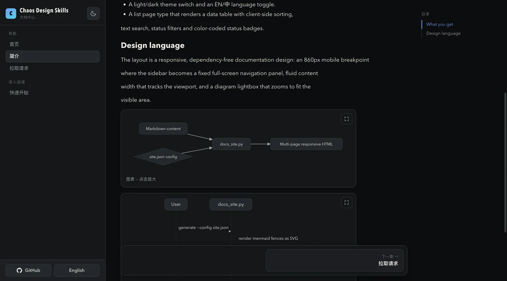
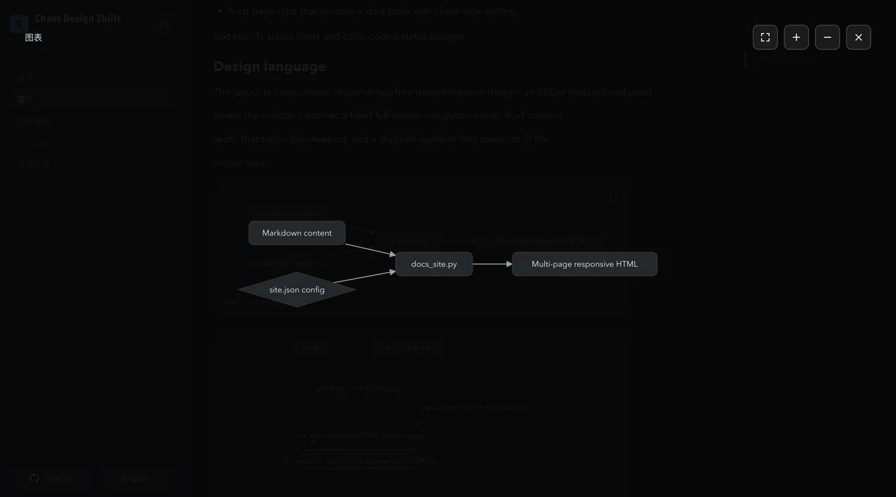
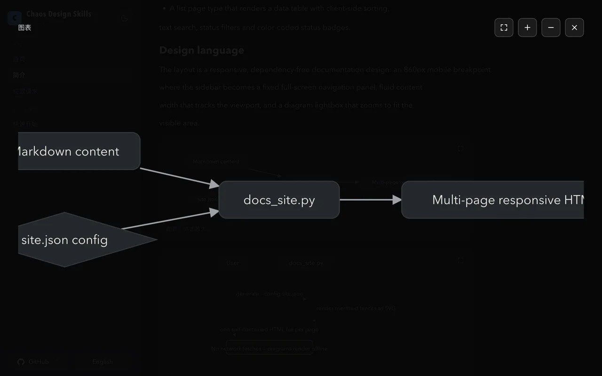
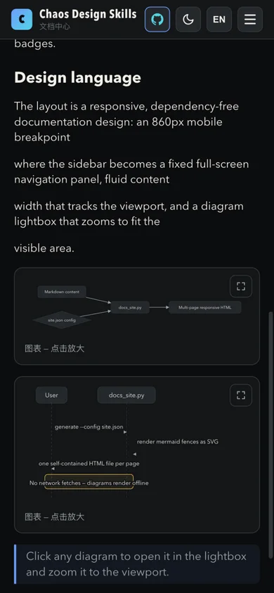

# 文档站（Docs Site）

[English](./README.md)

将 Markdown 内容与一份小型 JSON 配置，生成为**响应式、多页面、自包含**的静态文档站。无构建步骤、无外部运行时请求——每个页面都是一个可离线打开的 HTML 文件。

布局是一套深色优先、零依赖的响应式文档设计：固定 300px 侧边栏（品牌头部、可滚动的分组导航、吸底的 GitHub / 语言成对控件），内容列在锁定视口的外壳中独立滚动；860px 及以下时，固定顶栏（品牌、GitHub、主题、语言胶囊、三横线菜单键）将侧边栏展开为带独立滚动区和遮罩的全宽抽屉。内置明暗主题切换与真正的 中/EN 文案切换，两者均持久化到 localStorage。

## 特性

- **自动结构**——按配置为每个页面生成一个自包含 HTML 文件。
- **可配置导航**——扁平或分组菜单，带激活态追踪，链接指向真实的同级页面；桌面端为固定侧边栏，移动端为全宽抽屉，展开时自动把当前页滚动到可见区域。
- **格式集成**——文档页用 Markdown（支持可选 front-matter），列表页用 JSON 数据。
- **响应式 + 多页面**——视口锁定的双栏外壳中仅内容区滚动；≤860px 时启用固定顶栏与可变形汉堡键，点击遮罩或 Esc 关闭抽屉，内容宽度流式自适应不溢出；宽表格在独立容器内横向滚动，860–1200px 区间侧栏收敛为 250px。
- **列表页类型**——数据表格，支持客户端排序（任意列，包括提交数量与最后更新时间）、全文搜索、状态筛选与彩色状态徽章，以及实时匹配计数。
- **图表渲染 + 弹层**——` ```mermaid ` 代码块由内置零依赖渲染器绘制为内联 SVG（支持流程图与时序图，无法解析的语法回退为源码展示）。点击图表打开视口全屏弹层：超大图表缩放适配，小图保持原始尺寸不强行放大；放大后的弹层可滚动、可拖拽平移，任意局部都能看到。
- **锚点迷你目录 + 章节切换**——含两个及以上标题的文档页会在右侧显示吸顶迷你目录（支持 h2/h3/h4 多级缩进、滚动高亮，列表自动跟随当前小节便于快速定位）；上一章/下一章切换条固定吸底——毛玻璃质感、仅一条顶部分隔线，独立图层不随滚动抖动，按配置页序生成并随界面语言切换。
- **主题 + 国际化**——持久化的明暗切换（默认深色），以及可就地切换全部界面文案、导航项、列表控件与弹层按钮的中/EN 开关，并同步 `<html lang>`。

## 截图

均截取自真实生成的测试页面：图表渲染、放大弹层与移动端适配。










## 使用

```bash
python3 skills/docs-site/scripts/docs_site.py generate \
  --config site.json --content ./docs --out ./out
python3 skills/docs-site/scripts/docs_site.py check --out ./out
```

## 配置

```json
{
  "title": "我的文档",
  "tagline": "一句话简介",
  "repo": "github.com/owner/repo",
  "theme": "dark",
  "lang": "zh",
  "i18n": ["zh", "en"],
  "brand_mark": "M",
  "brand_sub": "Documentation",
  "brand_sub_zh": "文档中心",
  "breakpoint": 860,
  "nav": [
    {"slug": "introduction", "label": "Introduction", "label_zh": "简介"},
    {"slug": "guides", "label": "Guides", "label_zh": "指南", "group": "Deep dive",
     "group_zh": "深入阅读",
     "items": [{"slug": "quick-start", "label": "Quick start", "label_zh": "快速开始"}]}
  ],
  "pages": [
    {"slug": "introduction", "type": "doc", "source": "docs/introduction.md"},
    {"slug": "pull-requests", "type": "list",
     "source_data": "pr-data/pull-requests.json",
     "columns": [
       {"key": "number", "label": "#"},
       {"key": "title", "label": "标题", "link": "url"},
       {"key": "commits", "label": "提交数"},
       {"key": "last_updated", "label": "最后更新"},
       {"key": "status", "label": "状态"}
     ],
     "sortable": ["commits", "last_updated"],
     "status_field": "status",
     "filters": ["merged", "closed", "open", "in-review"]}
  ]
}
```

`breakpoint` 必须是整数像素宽度，非数字值会报错并中止生成。配置中的文案按其落点各转义一次（HTML 文本或内联脚本中的 JSON）；即使首页也列在 `nav` 中，导航里也只会有一个激活项。

完整字段见 `templates/site-config.sample.json` 与 `references/design.md`。

## 拉取请求列表

`list` 页类型专为渲染 Pull Request 表格设计。请填入**真实数据**（来自 git 历史或 GitHub API），不要手写假数据。`sortable` 中的列可点击排序；`status_field` 列渲染为徽章；`filters` 驱动状态下拉筛选。

```json
[
  {"number": 8, "title": "feat(site): mobile navigation panel",
   "author": "Rain120", "commits": 5, "status": "merged",
   "last_updated": "2026-10-14 14:17:19",
   "url": "https://github.com/chaos-design/skills/pull/8"}
]
```

## 输出

生成的文件位于 `--out` 目录下，每个页面对应一个 `<slug>.html`，自包含（内联 CSS/JS），可离线打开。

## 许可证

Apache-2.0。见 [LICENSE](./LICENSE)。
