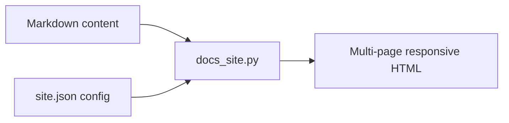

# Introduction

The `docs-site` skill turns **Markdown content + a small JSON config** into a
responsive, multi-page, self-contained static documentation site — no build
step, no external runtime fetches.

## What you get

- Multi-page static output: one self-contained HTML file per page.
- Automatic documentation structure generated from your config.
- A configurable navigation menu (flat or grouped), with active-state tracking.
- Markdown integration: headings, lists, tables, code fences, and diagrams.
- Responsive layout with a mobile top bar and full-screen navigation panel.
- A light/dark theme switch and an EN/中 language toggle.
- A list page type that renders a data table with client-side sorting,
  text search, status filters and color-coded status badges.

## Design language

The layout is a responsive, dependency-free documentation design: an 860px mobile breakpoint
where the sidebar becomes a fixed full-screen navigation panel, fluid content
width that tracks the viewport, and a diagram lightbox that zooms to fit the
visible area.

> Click any diagram to open it in the lightbox and zoom it to the viewport.
