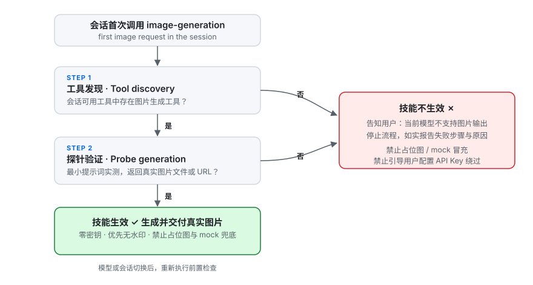

# Image Generation 图片生成

[English](./README.md)

根据文本描述生成图片，零密钥设计。本技能不读取、不申请、不保存任何 API Key：
所有图片一律通过宿主环境内置的图片生成能力产出。技能在会话内生效前会先执行
能力门禁——工具发现加一次最小探针生成——只有确认当前模型支持图片输出后才允许使用。

## 安装

```bash
npx skills add https://github.com/chaos-design/skills --skill image-generation
```

## 能力

| 阶段 | 执行者 | 结果 |
| --- | --- | --- |
| 能力门禁 | Agent，会话内首次调用时 | 第 1 步在会话可用工具（含延迟加载工具）中发现图片生成工具；第 2 步用最小提示词实际探针一次，并校验返回的是真实图片（文件或可访问 URL），而不是文本说明或占位内容。两步必须全部通过。 |
| 生成 | Agent | 收集用户的主体、风格、构图与氛围要求，按提示词建议补全 prompt，调用宿主图片生成工具，交付真实图片。 |
| 报告 | Agent | 任一环节失败时，说明失败发生在哪一步、原因是什么，然后停止。不提供占位图，不伪造输出，不引导用户"配置个 API Key"绕过。 |

## 示例

2026-10-11（UTC+8）的验证记录：能力门禁流程与其真实产出：

<p>
  
  
</p>

| 图片 | 说明 |
| --- | --- |
| `gate-flow.svg` | 生效前置检查流程图：先工具发现，再探针验证；两步全部通过技能才生效，任一失败即拒绝使用。 |
| `probe-red-circle.png` | 第 2 步探针对 `a single red circle on a white background` 的真实产出——无水印的 1024x1024 PNG（文件头、像素内容、角落像素均已校验）。 |

生成仅在门禁两步全部通过后进行。宿主的摄影类与插画类生成管线会强制附加
「AI 生成」标识，无法通过任何参数关闭，也不允许事后裁剪或涂抹去除，因此本文档
只嵌入无水印的探针产出与门禁流程图；探针原始产物在
[`tests/image-generation/`](../../tests/image-generation/)。

## 设计

- **门禁先行。** 未确认当前模型支持图片输出之前，技能不可用。门禁每个会话只跑一次，
  模型或会话切换后重新执行。
- **结构上零密钥。** 没有 `.env`、没有 API Key、没有 BASE_URL，也不存在任何可能向用户
  索要密钥的代码路径。宿主不具备图片生成能力时，正确结论是"技能不可用"，而不是改走
  密钥方案的旁路。
- **不伪造兜底。** 检查失败或生成失败都如实报告。占位图、ASCII 图形、文字描述都不允许
  替代真实生成结果。
- **探针产物不是交付物。** 探针图片只用于证明能力存在；用户的请求在其后重新生成。

## 用法

技能由指令驱动，Agent 按照 `SKILL.md` 执行：

1. 会话内第一次图片请求时，先执行能力门禁（工具发现，再做一次最小探针生成）。
2. 门禁不通过时，告知用户当前模型不支持图片输出，并停止。
3. 门禁通过后，按主体、风格、色彩、构图、氛围补全完整提示词，调用会话内的
   图片生成工具。
4. 交付真实图片文件或 URL；引用时间戳时使用 UTC+8，格式 `YYYY-MM-DD HH:mm:ss`。

| 请求参数 | 含义 | 默认值 | 必填 |
| --- | --- | --- | --- |
| `prompt` | 覆盖主体、风格、色彩、构图、氛围的描述文本 | 无 | 是 |
| `size` | 尺寸或比例，仅限宿主工具实际支持的取值 | 工具默认 | 否 |
| `count` | 生成张数 | 1 | 否 |
| `watermark` | 期望无水印交付；显式留空宿主工具的水印/脚注参数 | 无水印 | 否 |

## 依赖

- 宿主环境向 Agent 暴露内置图片生成工具（可从会话工具列表中发现）。
- 无网络凭据、无 API Key、无本地依赖。

## 非目标

- 不调用外部图片 API，也不接受任何 API Key。
- 不编辑已有图片，不生成视频，不产出 3D 模型。
- 能力缺失时不伪造输出；如实停止并说明。

## 许可证

Apache-2.0，见 [`LICENSE`](LICENSE)。
