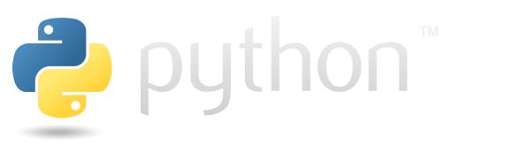
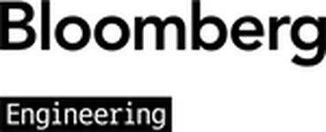
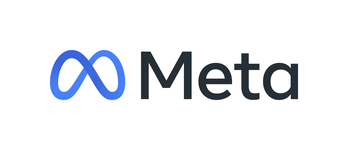

# Download Python | Python.org

> Source: https://www.python.org/downloads/
> Fetched: 2026-11-09 13:53:34

**Notice:** This page displays a fallback because interactive scripts did not run. Possible causes include disabled JavaScript or failure to load scripts or stylesheets.

[Skip to content](#content "Skip to content")

[▼ Close](#python-network)

* [Python](/ "The Python Programming Language")
* [PSF](https://www.python.org/psf/ "The Python Software Foundation")
* [Docs](https://docs.python.org "Python Documentation")
* [PyPI](https://pypi.org/ "Python Package Index")
* [Jobs](/jobs/ "Python Job Board")
* [Community](/community/)

[▲ The Python Network](#top)

[Donate](https://donate.python.org/)

[≡ Menu](#site-map)

Search This Site

GO

* **A A**
  + Smaller
  + Larger
  + Reset

* Socialize
  + [LinkedIn](https://www.linkedin.com/company/python-software-foundation/)
  + [Mastodon](https://fosstodon.org/%40ThePSF)
  + [Chat on IRC](/community/irc/)
  + [Twitter](https://twitter.com/ThePSF)

* [About](/about/)
  + [Applications](/about/apps/)
  + [Quotes](/about/quotes/)
  + [Getting Started](/about/gettingstarted/)
  + [Help](/about/help/)
* [Downloads](/downloads/)
  + [All releases](/downloads/)
  + [Source code](/downloads/source/)
  + [Windows](/downloads/windows/)
  + [macOS](/downloads/macos/)
  + [Android](/downloads/android/)
  + [iOS](/downloads/ios/)
  + [Other Platforms](/download/other/)
  + [License](https://docs.python.org/3/license.html)
  + [Alternative Implementations](/download/alternatives)
* [Documentation](/doc/)
  + [Docs](/doc/)
  + [Audio/Visual Talks](/doc/av)
  + [Beginner's Guide](https://wiki.python.org/python/getting-started/BeginnersGuide.html)
  + [FAQ](https://docs.python.org/3/faq/)
  + [Non-English Docs](https://translations.python.org/)
  + [PEP Index](https://peps.python.org)
  + [Python Books](https://wiki.python.org/moin/PythonBooks)
  + [Python Essays](/doc/essays/)
* [Community](/community/)
  + [Diversity](/community/diversity/)
  + [Mailing Lists](/community/lists/)
  + [IRC](/community/irc/)
  + [Forums](/community/forums/)
  + [PSF Annual Impact Report](/psf/annual-report/2024/)
  + [Python Conferences](/community/workshops/)
  + [Special Interest Groups](/community/sigs/)
  + [Python Logo](/community/logos/)
  + [Python Wiki](https://wiki.python.org/moin/)
  + [Code of Conduct](/psf/conduct/)
  + [Community Awards](/community/awards)
  + [Get Involved](/psf/get-involved/)
  + [Shared Stories](/psf/community-stories/)
* [Success Stories](/success-stories/ "success-stories")
  + [Arts](/success-stories/category/arts/)
  + [Business](/success-stories/category/business/)
  + [Education](/success-stories/category/education/)
  + [Engineering](/success-stories/category/engineering/)
  + [Government](/success-stories/category/government/)
  + [Scientific](/success-stories/category/scientific/)
  + [Software Development](/success-stories/category/software-development/)
* [News](/blogs/ "News from around the Python world")
  + [Python News](/blogs/ "Python Insider Blog Posts")
  + [PSF Newsletter](/psf/newsletter/ "Python Software Foundation Newsletter")
  + [PSF News](https://pyfound.blogspot.com "PSF Blog")
  + [PyCon US News](https://pycon.blogspot.com/ "PyCon Blog")
  + [Python Insider](https://blog.python.org "News and updates from the Python core team")
  + [News from the Community](https://planetpython.org/ "Planet Python")
* [Events](/events/)
  + [Python Events](/events/python-events/)
  + [User Group Events](/events/python-user-group/)
  + [Python Events Archive](/events/python-events/past/)
  + [User Group Events Archive](/events/python-user-group/past/)
  + [Submit an Event](https://wiki.python.org/moin/PythonEventsCalendar#Submitting_an_Event)

# Download the latest version for Android

# Download the latest source release

[Download Python 3.15.2](https://www.python.org/ftp/python/3.15.2/Python-3.15.2.tar.xz)

# Download the latest version for Windows

[Download Python install manager](https://www.python.org/ftp/python/pymanager/python-manager-26.4.msix)

Or get the standalone installer for [Python 3.15.2](https://www.python.org/ftp/python/3.15.2/python-3.15.2-amd64.exe)

# Download the latest version for iOS

# Download the latest version for macOS

[Download Python 3.15.2](https://www.python.org/ftp/python/3.15.2/python-3.15.2-macos11.pkg)

# Download the latest version of Python

[Download Python 3.15.2](/downloads/release/python-3152/)

Looking for Python with a different OS? Python for
[Windows](/downloads/windows/),
[Linux/Unix](/downloads/source/),
[macOS](/downloads/macos/),
[Android](/downloads/android/),
[iOS](/downloads/ios/),
[other](/download/other/)

Want to help test development versions of Python 3.16?
[Pre-releases](/downloads/latest/prerelease/),
[Docker images](https://gitlab.com/python-devs/ci-images)

Security notice: the emSign root CA has been removed from certifi. Upgrade certifi, pip, uv and sigstore now.   [See more](https://discuss.python.org/t/information-for-python-users-regarding-emudhra-emsign-ca-certificate-security-incident/109576)

## Active Python releases

[For more information visit the Python Developer's Guide](https://devguide.python.org/versions/#versions).

Python version
Maintenance status

First released
End of support
Release schedule

1. 3.16
   pre-release
   [Download](/downloads/latest/python3.16/)
   2027-10-06 (planned)
   2032-10
   [PEP 826](https://peps.python.org/pep-0826/)
2. 3.15
   bugfix
   [Download](/downloads/latest/python3.15/)
   2026-10-09
   2031-10
   [PEP 790](https://peps.python.org/pep-0790/)
3. 3.14
   bugfix
   [Download](/downloads/latest/python3.14/)
   2025-10-07
   2030-10
   [PEP 745](https://peps.python.org/pep-0745/)
4. 3.13
   security
   [Download](/downloads/latest/python3.13/)
   2024-10-07
   2029-10
   [PEP 719](https://peps.python.org/pep-0719/)
5. 3.12
   security
   [Download](/downloads/latest/python3.12/)
   2023-10-02
   2028-10
   [PEP 693](https://peps.python.org/pep-0693/)
6. 3.11
   security
   [Download](/downloads/latest/python3.11/)
   2022-10-24
   2027-10
   [PEP 664](https://peps.python.org/pep-0664/)
7. 3.10
   end-of-life, last release was [3.10.22](/downloads/release/python-31022/)
   [Download](/downloads/latest/python3.10/)
   2021-10-04
   2026-10-01
   [PEP 619](https://peps.python.org/pep-0619/)

## Looking for a specific release?

Python releases by version number:

Release version
Release date

Click for more

1. [Python 3.15.2](/downloads/release/python-3152/)
   Oct. 25, 2026
    [Download](/downloads/release/python-3152/)
   [Release notes](https://docs.python.org/release/3.15.2/whatsnew/changelog.html)
2. [Python 3.15.1](/downloads/release/python-3151/)
   Oct. 21, 2026
    [Download](/downloads/release/python-3151/)
   [Release notes](https://docs.python.org/release/3.15.1/whatsnew/changelog.html)
3. [Python 3.15.0](/downloads/release/python-3150/)
   Oct. 9, 2026
    [Download](/downloads/release/python-3150/)
   [Release notes](https://docs.python.org/release/3.15.0/whatsnew/changelog.html)
4. [Python 3.14.10](/downloads/release/python-31410/)
   Oct. 25, 2026
    [Download](/downloads/release/python-31410/)
   [Release notes](https://docs.python.org/release/3.14.10/whatsnew/changelog.html)
5. [Python 3.14.9](/downloads/release/python-3149/)
   Oct. 21, 2026
    [Download](/downloads/release/python-3149/)
   [Release notes](https://docs.python.org/release/3.14.9/whatsnew/changelog.html)
6. [Python 3.14.8](/downloads/release/python-3148/)
   Sept. 30, 2026
    [Download](/downloads/release/python-3148/)
   [Release notes](https://docs.python.org/release/3.14.8/whatsnew/changelog.html)
7. [Python 3.14.7](/downloads/release/python-3147/)
   Aug. 5, 2026
    [Download](/downloads/release/python-3147/)
   [Release notes](https://docs.python.org/release/3.14.7/whatsnew/changelog.html)
8. [Python 3.14.6](/downloads/release/python-3146/)
   June 10, 2026
    [Download](/downloads/release/python-3146/)
   [Release notes](https://docs.python.org/release/3.14.6/whatsnew/changelog.html)
9. [Python 3.14.5](/downloads/release/python-3145/)
   May 10, 2026
    [Download](/downloads/release/python-3145/)
   [Release notes](https://docs.python.org/release/3.14.5/whatsnew/changelog.html)
10. [Python 3.14.4](/downloads/release/python-3144/)
    April 7, 2026
     [Download](/downloads/release/python-3144/)
    [Release notes](https://docs.python.org/release/3.14.4/whatsnew/changelog.html)
11. [Python 3.14.3](/downloads/release/python-3143/)
    Feb. 3, 2026
     [Download](/downloads/release/python-3143/)
    [Release notes](https://docs.python.org/release/3.14.3/whatsnew/changelog.html)
12. [Python 3.14.2](/downloads/release/python-3142/)
    Dec. 5, 2025
     [Download](/downloads/release/python-3142/)
    [Release notes](https://docs.python.org/release/3.14.2/whatsnew/changelog.html)
13. [Python 3.14.1](/downloads/release/python-3141/)
    Dec. 2, 2025
     [Download](/downloads/release/python-3141/)
    [Release notes](https://docs.python.org/release/3.14.1/whatsnew/changelog.html)
14. [Python 3.14.0](/downloads/release/python-3140/)
    Oct. 7, 2025
     [Download](/downloads/release/python-3140/)
    [Release notes](https://docs.python.org/3.14/whatsnew/3.14.html)
15. [Python 3.13.18](/downloads/release/python-31318/)
    Oct. 25, 2026
     [Download](/downloads/release/python-31318/)
    [Release notes](https://docs.python.org/release/3.13.18/whatsnew/changelog.html)
16. [Python 3.13.17](/downloads/release/python-31317/)
    Oct. 21, 2026
     [Download](/downloads/release/python-31317/)
    [Release notes](https://docs.python.org/release/3.13.17/whatsnew/changelog.html)
17. [Python 3.13.16](/downloads/release/python-31316/)
    Sept. 30, 2026
     [Download](/downloads/release/python-31316/)
    [Release notes](https://docs.python.org/release/3.13.16/whatsnew/changelog.html)
18. [Python 3.13.15](/downloads/release/python-31315/)
    Aug. 5, 2026
     [Download](/downloads/release/python-31315/)
    [Release notes](https://docs.python.org/release/3.13.15/whatsnew/changelog.html)
19. [Python 3.13.14](/downloads/release/python-31314/)
    June 10, 2026
     [Download](/downloads/release/python-31314/)
    [Release notes](https://docs.python.org/release/3.13.14/whatsnew/changelog.html)
20. [Python 3.13.13](/downloads/release/python-31313/)
    April 7, 2026
     [Download](/downloads/release/python-31313/)
    [Release notes](https://docs.python.org/release/3.13.13/whatsnew/changelog.html)
21. [Python 3.13.12](/downloads/release/python-31312/)
    Feb. 3, 2026
     [Download](/downloads/release/python-31312/)
    [Release notes](https://docs.python.org/release/3.13.12/whatsnew/changelog.html)
22. [Python 3.13.11](/downloads/release/python-31311/)
    Dec. 5, 2025
     [Download](/downloads/release/python-31311/)
    [Release notes](https://docs.python.org/release/3.13.11/whatsnew/changelog.html)
23. [Python 3.13.10](/downloads/release/python-31310/)
    Dec. 2, 2025
     [Download](/downloads/release/python-31310/)
    [Release notes](https://docs.python.org/release/3.13.10/whatsnew/changelog.html)
24. [Python 3.13.9](/downloads/release/python-3139/)
    Oct. 14, 2025
     [Download](/downloads/release/python-3139/)
    [Release notes](https://docs.python.org/release/3.13.9/whatsnew/changelog.html#python-3-13-9)
25. [Python 3.13.8](/downloads/release/python-3138/)
    Oct. 7, 2025
     [Download](/downloads/release/python-3138/)
    [Release notes](https://docs.python.org/release/3.13.8/whatsnew/changelog.html#python-3-13-8)
26. [Python 3.13.7](/downloads/release/python-3137/)
    Aug. 14, 2025
     [Download](/downloads/release/python-3137/)
    [Release notes](https://docs.python.org/release/3.13.7/whatsnew/changelog.html)
27. [Python 3.13.6](/downloads/release/python-3136/)
    Aug. 6, 2025
     [Download](/downloads/release/python-3136/)
    [Release notes](https://docs.python.org/release/3.13.6/whatsnew/changelog.html#python-3-13-6)
28. [Python 3.13.5](/downloads/release/python-3135/)
    June 11, 2025
     [Download](/downloads/release/python-3135/)
    [Release notes](https://docs.python.org/release/3.13.5/whatsnew/changelog.html#python-3-13-5)
29. [Python 3.13.4](/downloads/release/python-3134/)
    June 3, 2025
     [Download](/downloads/release/python-3134/)
    [Release notes](https://docs.python.org/release/3.13.4/whatsnew/changelog.html#python-3-13-4)
30. [Python 3.13.3](/downloads/release/python-3133/)
    April 8, 2025
     [Download](/downloads/release/python-3133/)
    [Release notes](https://docs.python.org/release/3.13.3/whatsnew/changelog.html#python-3-13-3)
31. [Python 3.13.2](/downloads/release/python-3132/)
    Feb. 4, 2025
     [Download](/downloads/release/python-3132/)
    [Release notes](https://docs.python.org/release/3.13.2/whatsnew/changelog.html#python-3-13-2)
32. [Python 3.13.1](/downloads/release/python-3131/)
    Dec. 3, 2024
     [Download](/downloads/release/python-3131/)
    [Release notes](https://docs.python.org/release/3.13.1/whatsnew/changelog.html#python-3-13-1)
33. [Python 3.13.0](/downloads/release/python-3130/)
    Oct. 7, 2024
     [Download](/downloads/release/python-3130/)
    [Release notes](https://docs.python.org/release/3.13.0/whatsnew/changelog.html#python-3-13-0)
34. [Python 3.12.16](/downloads/release/python-31216/)
    Oct. 25, 2026
     [Download](/downloads/release/python-31216/)
    [Release notes](https://docs.python.org/release/3.12.16/whatsnew/changelog.html)
35. [Python 3.12.15](/downloads/release/python-31215/)
    Sept. 30, 2026
     [Download](/downloads/release/python-31215/)
    [Release notes](https://docs.python.org/release/3.12.15/whatsnew/changelog.html)
36. [Python 3.12.14](/downloads/release/python-31214/)
    Aug. 12, 2026
     [Download](/downloads/release/python-31214/)
    [Release notes](https://docs.python.org/release/3.12.14/whatsnew/changelog.html)
37. [Python 3.12.13](/downloads/release/python-31213/)
    March 3, 2026
     [Download](/downloads/release/python-31213/)
    [Release notes](https://docs.python.org/release/3.12.13/whatsnew/changelog.html#python-3-12-13)
38. [Python 3.12.12](/downloads/release/python-31212/)
    Oct. 9, 2025
     [Download](/downloads/release/python-31212/)
    [Release notes](https://docs.python.org/release/3.12.12/whatsnew/changelog.html#python-3-12-12)
39. [Python 3.12.11](/downloads/release/python-31211/)
    June 3, 2025
     [Download](/downloads/release/python-31211/)
    [Release notes](https://docs.python.org/release/3.12.11/whatsnew/changelog.html#python-3-12-11)
40. [Python 3.12.10](/downloads/release/python-31210/)
    April 8, 2025
     [Download](/downloads/release/python-31210/)
    [Release notes](https://docs.python.org/release/3.12.10/whatsnew/changelog.html#python-3-12-10)
41. [Python 3.12.9](/downloads/release/python-3129/)
    Feb. 4, 2025
     [Download](/downloads/release/python-3129/)
    [Release notes](https://docs.python.org/release/3.12.9/whatsnew/changelog.html#python-3-12-9)
42. [Python 3.12.8](/downloads/release/python-3128/)
    Dec. 3, 2024
     [Download](/downloads/release/python-3128/)
    [Release notes](https://docs.python.org/release/3.12.8/whatsnew/changelog.html#python-3-12-8)
43. [Python 3.12.7](/downloads/release/python-3127/)
    Oct. 1, 2024
     [Download](/downloads/release/python-3127/)
    [Release notes](https://docs.python.org/release/3.12.7/whatsnew/changelog.html#python-3-12-7)
44. [Python 3.12.6](/downloads/release/python-3126/)
    Sept. 6, 2024
     [Download](/downloads/release/python-3126/)
    [Release notes](https://docs.python.org/release/3.12.6/whatsnew/changelog.html#python-3-12-6)
45. [Python 3.12.5](/downloads/release/python-3125/)
    Aug. 6, 2024
     [Download](/downloads/release/python-3125/)
    [Release notes](https://docs.python.org/release/3.12.5/whatsnew/changelog.html#python-3-12-5)
46. [Python 3.12.4](/downloads/release/python-3124/)
    June 6, 2024
     [Download](/downloads/release/python-3124/)
    [Release notes](https://docs.python.org/release/3.12.4/whatsnew/changelog.html#python-3-12-4)
47. [Python 3.12.3](/downloads/release/python-3123/)
    April 9, 2024
     [Download](/downloads/release/python-3123/)
    [Release notes](https://docs.python.org/release/3.12.3/whatsnew/changelog.html#python-3-12-2)
48. [Python 3.12.2](/downloads/release/python-3122/)
    Feb. 6, 2024
     [Download](/downloads/release/python-3122/)
    [Release notes](https://docs.python.org/release/3.12.2/whatsnew/changelog.html#python-3-12-2)
49. [Python 3.12.1](/downloads/release/python-3121/)
    Dec. 8, 2023
     [Download](/downloads/release/python-3121/)
    [Release notes](https://docs.python.org/release/3.12.1/whatsnew/changelog.html#python-3-12-1)
50. [Python 3.12.0](/downloads/release/python-3120/)
    Oct. 2, 2023
     [Download](/downloads/release/python-3120/)
    [Release notes](https://docs.python.org/release/3.12.0/whatsnew/changelog.html#python-3-12-0)
51. [Python 3.11.18](/downloads/release/python-31118/)
    Oct. 25, 2026
     [Download](/downloads/release/python-31118/)
    [Release notes](https://docs.python.org/release/3.11.18/whatsnew/changelog.html)
52. [Python 3.11.17](/downloads/release/python-31117/)
    Oct. 1, 2026
     [Download](/downloads/release/python-31117/)
    [Release notes](https://docs.python.org/release/3.11.17/whatsnew/changelog.html)
53. [Python 3.11.16](/downloads/release/python-31116/)
    Aug. 12, 2026
     [Download](/downloads/release/python-31116/)
    [Release notes](https://docs.python.org/release/3.11.16/whatsnew/changelog.html)
54. [Python 3.11.15](/downloads/release/python-31115/)
    March 3, 2026
     [Download](/downloads/release/python-31115/)
    [Release notes](https://docs.python.org/release/3.11.15/whatsnew/changelog.html)
55. [Python 3.11.14](/downloads/release/python-31114/)
    Oct. 9, 2025
     [Download](/downloads/release/python-31114/)
    [Release notes](https://docs.python.org/release/3.11.14/whatsnew/changelog.html#python-3-11-14)
56. [Python 3.11.13](/downloads/release/python-31113/)
    June 3, 2025
     [Download](/downloads/release/python-31113/)
    [Release notes](https://docs.python.org/release/3.11.13/whatsnew/changelog.html#python-3-11-13)
57. [Python 3.11.12](/downloads/release/python-31112/)
    April 8, 2025
     [Download](/downloads/release/python-31112/)
    [Release notes](https://docs.python.org/release/3.11.12/whatsnew/changelog.html#python-3-11-12)
58. [Python 3.11.11](/downloads/release/python-31111/)
    Dec. 3, 2024
     [Download](/downloads/release/python-31111/)
    [Release notes](https://docs.python.org/release/3.11.11/whatsnew/changelog.html#python-3-11-11)
59. [Python 3.11.10](/downloads/release/python-31110/)
    Sept. 7, 2024
     [Download](/downloads/release/python-31110/)
    [Release notes](https://docs.python.org/release/3.11.10/whatsnew/changelog.html#python-3-11-10)
60. [Python 3.11.9](/downloads/release/python-3119/)
    April 2, 2024
     [Download](/downloads/release/python-3119/)
    [Release notes](https://docs.python.org/release/3.11.9/whatsnew/changelog.html#python-3-11-9)
61. [Python 3.11.8](/downloads/release/python-3118/)
    Feb. 6, 2024
     [Download](/downloads/release/python-3118/)
    [Release notes](https://docs.python.org/release/3.11.8/whatsnew/changelog.html#python-3-11-8)
62. [Python 3.11.7](/downloads/release/python-3117/)
    Dec. 4, 2023
     [Download](/downloads/release/python-3117/)
    [Release notes](https://docs.python.org/release/3.11.7/whatsnew/changelog.html#python-3-11-7)
63. [Python 3.11.6](/downloads/release/python-3116/)
    Oct. 2, 2023
     [Download](/downloads/release/python-3116/)
    [Release notes](https://docs.python.org/release/3.11.6/whatsnew/changelog.html#python-3-11-6)
64. [Python 3.11.5](/downloads/release/python-3115/)
    Aug. 24, 2023
     [Download](/downloads/release/python-3115/)
    [Release notes](https://docs.python.org/release/3.11.5/whatsnew/changelog.html#python-3-11-5)
65. [Python 3.11.4](/downloads/release/python-3114/)
    June 6, 2023
     [Download](/downloads/release/python-3114/)
    [Release notes](https://docs.python.org/release/3.11.4/whatsnew/changelog.html#python-3-11-4)
66. [Python 3.11.3](/downloads/release/python-3113/)
    April 5, 2023
     [Download](/downloads/release/python-3113/)
    [Release notes](https://docs.python.org/release/3.11.3/whatsnew/changelog.html#python-3-11-3)
67. [Python 3.11.2](/downloads/release/python-3112/)
    Feb. 8, 2023
     [Download](/downloads/release/python-3112/)
    [Release notes](https://docs.python.org/release/3.11.2/whatsnew/changelog.html#python-3-11-2)
68. [Python 3.11.1](/downloads/release/python-3111/)
    Dec. 6, 2022
     [Download](/downloads/release/python-3111/)
    [Release notes](https://docs.python.org/release/3.11.1/whatsnew/changelog.html#python-3-11-1)
69. [Python 3.11.0](/downloads/release/python-3110/)
    Oct. 24, 2022
     [Download](/downloads/release/python-3110/)
    [Release notes](https://docs.python.org/release/3.11.0/whatsnew/changelog.html#python-3-11-0-final)
70. [Python 3.10.22](/downloads/release/python-31022/)
    Oct. 1, 2026
     [Download](/downloads/release/python-31022/)
    [Release notes](https://docs.python.org/release/3.10.22/whatsnew/changelog.html)
71. [Python 3.10.21](/downloads/release/python-31021/)
    Aug. 12, 2026
     [Download](/downloads/release/python-31021/)
    [Release notes](https://docs.python.org/release/3.10.21/whatsnew/changelog.html)
72. [Python 3.10.20](/downloads/release/python-31020/)
    March 3, 2026
     [Download](/downloads/release/python-31020/)
    [Release notes](https://docs.python.org/release/3.10.20/whatsnew/changelog.html)
73. [Python 3.10.19](/downloads/release/python-31019/)
    Oct. 9, 2025
     [Download](/downloads/release/python-31019/)
    [Release notes](https://docs.python.org/release/3.10.19/whatsnew/changelog.html)
74. [Python 3.10.18](/downloads/release/python-31018/)
    June 3, 2025
     [Download](/downloads/release/python-31018/)
    [Release notes](https://docs.python.org/release/3.10.18/whatsnew/changelog.html)
75. [Python 3.10.17](/downloads/release/python-31017/)
    April 8, 2025
     [Download](/downloads/release/python-31017/)
    [Release notes](https://docs.python.org/release/3.10.17/whatsnew/changelog.html)
76. [Python 3.10.16](/downloads/release/python-31016/)
    Dec. 3, 2024
     [Download](/downloads/release/python-31016/)
    [Release notes](https://docs.python.org/release/3.10.16/whatsnew/changelog.html)
77. [Python 3.10.15](/downloads/release/python-31015/)
    Sept. 7, 2024
     [Download](/downloads/release/python-31015/)
    [Release notes](https://docs.python.org/release/3.10.15/whatsnew/changelog.html)
78. [Python 3.10.14](/downloads/release/python-31014/)
    March 19, 2024
     [Download](/downloads/release/python-31014/)
    [Release notes](https://docs.python.org/release/3.10.14/whatsnew/changelog.html)
79. [Python 3.10.13](/downloads/release/python-31013/)
    Aug. 24, 2023
     [Download](/downloads/release/python-31013/)
    [Release notes](https://docs.python.org/release/3.10.13/whatsnew/changelog.html#python-3-10-13-final)
80. [Python 3.10.12](/downloads/release/python-31012/)
    June 6, 2023
     [Download](/downloads/release/python-31012/)
    [Release notes](https://docs.python.org/release/3.10.12/whatsnew/changelog.html#python-3-10-12-final)
81. [Python 3.10.11](/downloads/release/python-31011/)
    April 5, 2023
     [Download](/downloads/release/python-31011/)
    [Release notes](https://docs.python.org/release/3.10.11/whatsnew/changelog.html#python-3-10-11-final)
82. [Python 3.10.10](/downloads/release/python-31010/)
    Feb. 8, 2023
     [Download](/downloads/release/python-31010/)
    [Release notes](https://docs.python.org/release/3.10.10/whatsnew/changelog.html#python-3-10-10-final)
83. [Python 3.10.9](/downloads/release/python-3109/)
    Dec. 6, 2022
     [Download](/downloads/release/python-3109/)
    [Release notes](https://docs.python.org/release/3.10.9/whatsnew/changelog.html#python-3-10-9-final)
84. [Python 3.10.8](/downloads/release/python-3108/)
    Oct. 11, 2022
     [Download](/downloads/release/python-3108/)
    [Release notes](https://docs.python.org/release/3.10.8/whatsnew/changelog.html#python-3-10-8-final)
85. [Python 3.10.7](/downloads/release/python-3107/)
    Sept. 6, 2022
     [Download](/downloads/release/python-3107/)
    [Release notes](https://docs.python.org/release/3.10.7/whatsnew/changelog.html#python-3-10-7-final)
86. [Python 3.10.6](/downloads/release/python-3106/)
    Aug. 2, 2022
     [Download](/downloads/release/python-3106/)
    [Release notes](https://docs.python.org/release/3.10.6/whatsnew/changelog.html#python-3-10-6-final)
87. [Python 3.10.5](/downloads/release/python-3105/)
    June 6, 2022
     [Download](/downloads/release/python-3105/)
    [Release notes](https://docs.python.org/release/3.10.5/whatsnew/changelog.html#python-3-10-5-final)
88. [Python 3.10.4](/downloads/release/python-3104/)
    March 24, 2022
     [Download](/downloads/release/python-3104/)
    [Release notes](https://docs.python.org/release/3.10.4/whatsnew/changelog.html#python-3-10-4-final)
89. [Python 3.10.3](/downloads/release/python-3103/)
    March 16, 2022
     [Download](/downloads/release/python-3103/)
    [Release notes](https://docs.python.org/release/3.10.3/whatsnew/changelog.html#python-3-10-3-final)
90. [Python 3.10.2](/downloads/release/python-3102/)
    Jan. 14, 2022
     [Download](/downloads/release/python-3102/)
    [Release notes](https://docs.python.org/release/3.10.2/whatsnew/changelog.html#python-3-10-2-final)
91. [Python 3.10.1](/downloads/release/python-3101/)
    Dec. 6, 2021
     [Download](/downloads/release/python-3101/)
    [Release notes](https://docs.python.org/release/3.10.1/whatsnew/changelog.html#python-3-10-1-final)
92. [Python 3.10.0](/downloads/release/python-3100/)
    Oct. 4, 2021
     [Download](/downloads/release/python-3100/)
    [Release notes](https://docs.python.org/release/3.10.0/whatsnew/changelog.html#python-3-10-0-final)
93. [Python 3.9.25](/downloads/release/python-3925/)
    Oct. 31, 2025
     [Download](/downloads/release/python-3925/)
    [Release notes](https://docs.python.org/release/3.9.25/whatsnew/changelog.html)
94. [Python 3.9.24](/downloads/release/python-3924/)
    Oct. 9, 2025
     [Download](/downloads/release/python-3924/)
    [Release notes](https://docs.python.org/release/3.9.24/whatsnew/changelog.html)
95. [Python 3.9.23](/downloads/release/python-3923/)
    June 3, 2025
     [Download](/downloads/release/python-3923/)
    [Release notes](https://docs.python.org/release/3.9.23/whatsnew/changelog.html)
96. [Python 3.9.22](/downloads/release/python-3922/)
    April 8, 2025
     [Download](/downloads/release/python-3922/)
    [Release notes](https://docs.python.org/release/3.9.22/whatsnew/changelog.html)
97. [Python 3.9.21](/downloads/release/python-3921/)
    Dec. 3, 2024
     [Download](/downloads/release/python-3921/)
    [Release notes](https://docs.python.org/release/3.9.21/whatsnew/changelog.html)
98. [Python 3.9.20](/downloads/release/python-3920/)
    Sept. 6, 2024
     [Download](/downloads/release/python-3920/)
    [Release notes](https://docs.python.org/release/3.9.20/whatsnew/changelog.html)
99. [Python 3.9.19](/downloads/release/python-3919/)
    March 19, 2024
     [Download](/downloads/release/python-3919/)
    [Release notes](https://docs.python.org/release/3.9.19/whatsnew/changelog.html)
100. [Python 3.9.18](/downloads/release/python-3918/)
     Aug. 24, 2023
      [Download](/downloads/release/python-3918/)
     [Release notes](https://docs.python.org/release/3.9.18/whatsnew/changelog.html#changelog)
101. [Python 3.9.17](/downloads/release/python-3917/)
     June 6, 2023
      [Download](/downloads/release/python-3917/)
     [Release notes](https://docs.python.org/release/3.9.17/whatsnew/changelog.html#changelog)
102. [Python 3.9.16](/downloads/release/python-3916/)
     Dec. 6, 2022
      [Download](/downloads/release/python-3916/)
     [Release notes](http://docs.python.org/release/3.9.16/whatsnew/changelog.html)
103. [Python 3.9.15](/downloads/release/python-3915/)
     Oct. 11, 2022
      [Download](/downloads/release/python-3915/)
     [Release notes](http://docs.python.org/release/3.9.15/whatsnew/changelog.html)
104. [Python 3.9.14](/downloads/release/python-3914/)
     Sept. 6, 2022
      [Download](/downloads/release/python-3914/)
     [Release notes](http://docs.python.org/release/3.9.14/whatsnew/changelog.html)
105. [Python 3.9.13](/downloads/release/python-3913/)
     May 17, 2022
      [Download](/downloads/release/python-3913/)
     [Release notes](https://docs.python.org/release/3.9.13/whatsnew/changelog.html)
106. [Python 3.9.12](/downloads/release/python-3912/)
     March 23, 2022
      [Download](/downloads/release/python-3912/)
     [Release notes](https://docs.python.org/release/3.9.12/whatsnew/changelog.html)
107. [Python 3.9.11](/downloads/release/python-3911/)
     March 16, 2022
      [Download](/downloads/release/python-3911/)
     [Release notes](https://docs.python.org/release/3.9.11/whatsnew/changelog.html)
108. [Python 3.9.10](/downloads/release/python-3910/)
     Jan. 14, 2022
      [Download](/downloads/release/python-3910/)
     [Release notes](https://docs.python.org/release/3.9.10/whatsnew/changelog.html)
109. [Python 3.9.9](/downloads/release/python-399/)
     Nov. 15, 2021
      [Download](/downloads/release/python-399/)
     [Release notes](https://docs.python.org/release/3.9.9/whatsnew/changelog.html)
110. [Python 3.9.8](/downloads/release/python-398/)
     Nov. 5, 2021
      [Download](/downloads/release/python-398/)
     [Release notes](https://docs.python.org/release/3.9.8/whatsnew/changelog.html)
111. [Python 3.9.7](/downloads/release/python-397/)
     Aug. 30, 2021
      [Download](/downloads/release/python-397/)
     [Release notes](https://docs.python.org/release/3.9.7/whatsnew/changelog.html#changelog)
112. [Python 3.9.6](/downloads/release/python-396/)
     June 28, 2021
      [Download](/downloads/release/python-396/)
     [Release notes](https://docs.python.org/release/3.9.6/whatsnew/changelog.html#changelog)
113. [Python 3.9.5](/downloads/release/python-395/)
     May 3, 2021
      [Download](/downloads/release/python-395/)
     [Release notes](https://docs.python.org/release/3.9.5/whatsnew/changelog.html)
114. [Python 3.9.4](/downloads/release/python-394/)
     April 4, 2021
      [Download](/downloads/release/python-394/)
     [Release notes](https://docs.python.org/release/3.9.4/whatsnew/changelog.html#changelog)
115. [Python 3.9.2](/downloads/release/python-392/)
     Feb. 19, 2021
      [Download](/downloads/release/python-392/)
     [Release notes](https://docs.python.org/release/3.9.2/whatsnew/changelog.html#changelog)
116. [Python 3.9.1](/downloads/release/python-391/)
     Dec. 7, 2020
      [Download](/downloads/release/python-391/)
     [Release notes](https://docs.python.org/release/3.9.1/whatsnew/changelog.html#changelog)
117. [Python 3.9.0](/downloads/release/python-390/)
     Oct. 5, 2020
      [Download](/downloads/release/python-390/)
     [Release notes](https://docs.python.org/release/3.9.0/whatsnew/changelog.html#changelog)
118. [Python 3.8.20](/downloads/release/python-3820/)
     Sept. 6, 2024
      [Download](/downloads/release/python-3820/)
     [Release notes](https://docs.python.org/release/3.8.20/whatsnew/changelog.html)
119. [Python 3.8.19](/downloads/release/python-3819/)
     March 19, 2024
      [Download](/downloads/release/python-3819/)
     [Release notes](https://docs.python.org/release/3.8.19/whatsnew/changelog.html)
120. [Python 3.8.18](/downloads/release/python-3818/)
     Aug. 24, 2023
      [Download](/downloads/release/python-3818/)
     [Release notes](https://docs.python.org/release/3.8.18/whatsnew/changelog.html#changelog)
121. [Python 3.8.17](/downloads/release/python-3817/)
     June 6, 2023
      [Download](/downloads/release/python-3817/)
     [Release notes](http://docs.python.org/release/3.8.17/whatsnew/changelog.html)
122. [Python 3.8.16](/downloads/release/python-3816/)
     Dec. 6, 2022
      [Download](/downloads/release/python-3816/)
     [Release notes](http://docs.python.org/release/3.8.16/whatsnew/changelog.html)
123. [Python 3.8.15](/downloads/release/python-3815/)
     Oct. 11, 2022
      [Download](/downloads/release/python-3815/)
     [Release notes](http://docs.python.org/release/3.8.15/whatsnew/changelog.html)
124. [Python 3.8.14](/downloads/release/python-3814/)
     Sept. 6, 2022
      [Download](/downloads/release/python-3814/)
     [Release notes](http://docs.python.org/release/3.8.14/whatsnew/changelog.html)
125. [Python 3.8.13](/downloads/release/python-3813/)
     March 16, 2022
      [Download](/downloads/release/python-3813/)
     [Release notes](https://docs.python.org/release/3.8.13/whatsnew/changelog.html)
126. [Python 3.8.12](/downloads/release/python-3812/)
     Aug. 30, 2021
      [Download](/downloads/release/python-3812/)
     [Release notes](https://docs.python.org/release/3.8.12/whatsnew/changelog.html#changelog)
127. [Python 3.8.11](/downloads/release/python-3811/)
     June 28, 2021
      [Download](/downloads/release/python-3811/)
     [Release notes](https://docs.python.org/release/3.8.11/whatsnew/changelog.html#changelog)
128. [Python 3.8.10](/downloads/release/python-3810/)
     May 3, 2021
      [Download](/downloads/release/python-3810/)
     [Release notes](https://docs.python.org/release/3.8.10/whatsnew/changelog.html)
129. [Python 3.8.9](/downloads/release/python-389/)
     April 2, 2021
      [Download](/downloads/release/python-389/)
     [Release notes](https://docs.python.org/release/3.8.9/whatsnew/changelog.html#python-3-8-9)
130. [Python 3.8.8](/downloads/release/python-388/)
     Feb. 19, 2021
      [Download](/downloads/release/python-388/)
     [Release notes](https://docs.python.org/release/3.8.8/whatsnew/changelog.html#changelog)
131. [Python 3.8.7](/downloads/release/python-387/)
     Dec. 21, 2020
      [Download](/downloads/release/python-387/)
     [Release notes](https://docs.python.org/release/3.8.7/whatsnew/changelog.html)
132. [Python 3.8.6](/downloads/release/python-386/)
     Sept. 24, 2020
      [Download](/downloads/release/python-386/)
     [Release notes](https://docs.python.org/release/3.8.6/whatsnew/changelog.html#changelog)
133. [Python 3.8.5](/downloads/release/python-385/)
     July 20, 2020
      [Download](/downloads/release/python-385/)
     [Release notes](https://docs.python.org/release/3.8.5/whatsnew/changelog.html#changelog)
134. [Python 3.8.4](/downloads/release/python-384/)
     July 13, 2020
      [Download](/downloads/release/python-384/)
     [Release notes](https://docs.python.org/release/3.8.4/whatsnew/changelog.html#changelog)
135. [Python 3.8.3](/downloads/release/python-383/)
     May 13, 2020
      [Download](/downloads/release/python-383/)
     [Release notes](https://docs.python.org/release/3.8.3/whatsnew/changelog.html#changelog)
136. [Python 3.8.2](/downloads/release/python-382/)
     Feb. 24, 2020
      [Download](/downloads/release/python-382/)
     [Release notes](https://docs.python.org/release/3.8.2/whatsnew/changelog.html#python-3-8-2-final)
137. [Python 3.8.1](/downloads/release/python-381/)
     Dec. 18, 2019
      [Download](/downloads/release/python-381/)
     [Release notes](https://docs.python.org/3.8/whatsnew/changelog.html#python-3-8-1)
138. [Python 3.8.0](/downloads/release/python-380/)
     Oct. 14, 2019
      [Download](/downloads/release/python-380/)
     [Release notes](https://docs.python.org/3.8/whatsnew/changelog.html#python-3-8-0-final)
139. [Python 3.7.17](/downloads/release/python-3717/)
     June 6, 2023
      [Download](/downloads/release/python-3717/)
     [Release notes](https://docs.python.org/release/3.7.17/whatsnew/changelog.html#changelog)
140. [Python 3.7.16](/downloads/release/python-3716/)
     Dec. 6, 2022
      [Download](/downloads/release/python-3716/)
     [Release notes](https://docs.python.org/release/3.7.16/whatsnew/changelog.html#changelog)
141. [Python 3.7.15](/downloads/release/python-3715/)
     Oct. 11, 2022
      [Download](/downloads/release/python-3715/)
     [Release notes](https://docs.python.org/release/3.7.15/whatsnew/changelog.html#changelog)
142. [Python 3.7.14](/downloads/release/python-3714/)
     Sept. 6, 2022
      [Download](/downloads/release/python-3714/)
     [Release notes](https://docs.python.org/release/3.7.14/whatsnew/changelog.html#changelog)
143. [Python 3.7.13](/downloads/release/python-3713/)
     March 16, 2022
      [Download](/downloads/release/python-3713/)
     [Release notes](https://docs.python.org/release/3.7.13/whatsnew/changelog.html#changelog)
144. [Python 3.7.12](/downloads/release/python-3712/)
     Sept. 4, 2021
      [Download](/downloads/release/python-3712/)
     [Release notes](https://docs.python.org/release/3.7.12/whatsnew/changelog.html#changelog)
145. [Python 3.7.11](/downloads/release/python-3711/)
     June 28, 2021
      [Download](/downloads/release/python-3711/)
     [Release notes](https://docs.python.org/release/3.7.11/whatsnew/changelog.html#changelog)
146. [Python 3.7.10](/downloads/release/python-3710/)
     Feb. 15, 2021
      [Download](/downloads/release/python-3710/)
     [Release notes](https://docs.python.org/release/3.7.10/whatsnew/changelog.html#changelog)
147. [Python 3.7.9](/downloads/release/python-379/)
     Aug. 17, 2020
      [Download](/downloads/release/python-379/)
     [Release notes](https://docs.python.org/release/3.7.9/whatsnew/changelog.html#changelog)
148. [Python 3.7.8](/downloads/release/python-378/)
     June 27, 2020
      [Download](/downloads/release/python-378/)
     [Release notes](https://docs.python.org/release/3.7.8/whatsnew/changelog.html#changelog)
149. [Python 3.7.7](/downloads/release/python-377/)
     March 10, 2020
      [Download](/downloads/release/python-377/)
     [Release notes](https://docs.python.org/3.7/whatsnew/changelog.html#python-3-7-7-final)
150. [Python 3.7.6](/downloads/release/python-376/)
     Dec. 18, 2019
      [Download](/downloads/release/python-376/)
     [Release notes](https://docs.python.org/3.7/whatsnew/changelog.html#python-3-7-6-final)
151. [Python 3.7.5](/downloads/release/python-375/)
     Oct. 15, 2019
      [Download](/downloads/release/python-375/)
     [Release notes](https://docs.python.org/3.7/whatsnew/changelog.html#python-3-7-5-final)
152. [Python 3.7.4](/downloads/release/python-374/)
     July 8, 2019
      [Download](/downloads/release/python-374/)
     [Release notes](https://docs.python.org/3.7/whatsnew/changelog.html#python-3-7-4-final)
153. [Python 3.7.3](/downloads/release/python-373/)
     March 25, 2019
      [Download](/downloads/release/python-373/)
     [Release notes](https://docs.python.org/3.7/whatsnew/changelog.html#python-3-7-3-final)
154. [Python 3.7.2](/downloads/release/python-372/)
     Dec. 24, 2018
      [Download](/downloads/release/python-372/)
     [Release notes](https://docs.python.org/3.7/whatsnew/changelog.html#python-3-7-2-final)
155. [Python 3.7.1](/downloads/release/python-371/)
     Oct. 20, 2018
      [Download](/downloads/release/python-371/)
     [Release notes](https://docs.python.org/3.7/whatsnew/changelog.html#python-3-7-1-final)
156. [Python 3.7.0](/downloads/release/python-370/)
     June 27, 2018
      [Download](/downloads/release/python-370/)
     [Release notes](https://docs.python.org/3.7/whatsnew/changelog.html#python-3-7-0-final)
157. [Python 3.6.15](/downloads/release/python-3615/)
     Sept. 4, 2021
      [Download](/downloads/release/python-3615/)
     [Release notes](https://docs.python.org/release/3.6.15/whatsnew/changelog.html#changelog)
158. [Python 3.6.14](/downloads/release/python-3614/)
     June 28, 2021
      [Download](/downloads/release/python-3614/)
     [Release notes](https://docs.python.org/release/3.6.14/whatsnew/changelog.html#changelog)
159. [Python 3.6.13](/downloads/release/python-3613/)
     Feb. 15, 2021
      [Download](/downloads/release/python-3613/)
     [Release notes](https://docs.python.org/release/3.6.13/whatsnew/changelog.html#changelog)
160. [Python 3.6.12](/downloads/release/python-3612/)
     Aug. 17, 2020
      [Download](/downloads/release/python-3612/)
     [Release notes](https://docs.python.org/release/3.6.12/whatsnew/changelog.html#changelog)
161. [Python 3.6.11](/downloads/release/python-3611/)
     June 27, 2020
      [Download](/downloads/release/python-3611/)
     [Release notes](https://docs.python.org/release/3.6.11/whatsnew/changelog.html#changelog)
162. [Python 3.6.10](/downloads/release/python-3610/)
     Dec. 18, 2019
      [Download](/downloads/release/python-3610/)
     [Release notes](https://docs.python.org/3.6/whatsnew/changelog.html#python-3-6-10-final)
163. [Python 3.6.9](/downloads/release/python-369/)
     July 2, 2019
      [Download](/downloads/release/python-369/)
     [Release notes](https://docs.python.org/3.6/whatsnew/changelog.html#python-3-6-9-final)
164. [Python 3.6.8](/downloads/release/python-368/)
     Dec. 24, 2018
      [Download](/downloads/release/python-368/)
     [Release notes](https://docs.python.org/3.6/whatsnew/changelog.html#python-3-6-8-final)
165. [Python 3.6.7](/downloads/release/python-367/)
     Oct. 20, 2018
      [Download](/downloads/release/python-367/)
     [Release notes](https://docs.python.org/3.6/whatsnew/changelog.html#python-3-6-7-final)
166. [Python 3.6.6](/downloads/release/python-366/)
     June 27, 2018
      [Download](/downloads/release/python-366/)
     [Release notes](https://docs.python.org/3.6/whatsnew/changelog.html#python-3-6-6-final)
167. [Python 3.6.5](/downloads/release/python-365/)
     March 28, 2018
      [Download](/downloads/release/python-365/)
     [Release notes](https://docs.python.org/3.6/whatsnew/changelog.html#python-3-6-5-final)
168. [Python 3.6.4](/downloads/release/python-364/)
     Dec. 19, 2017
      [Download](/downloads/release/python-364/)
     [Release notes](https://docs.python.org/3.6/whatsnew/changelog.html#python-3-6-4-final)
169. [Python 3.6.3](/downloads/release/python-363/)
     Oct. 3, 2017
      [Download](/downloads/release/python-363/)
     [Release notes](https://docs.python.org/3.6/whatsnew/changelog.html#python-3-6-3-final)
170. [Python 3.6.2](/downloads/release/python-362/)
     July 17, 2017
      [Download](/downloads/release/python-362/)
     [Release notes](https://docs.python.org/3.6/whatsnew/changelog.html#python-3-6-2-final)
171. [Python 3.6.1](/downloads/release/python-361/)
     March 21, 2017
      [Download](/downloads/release/python-361/)
     [Release notes](https://docs.python.org/3.6/whatsnew/changelog.html#python-3-6-1-final)
172. [Python 3.6.0](/downloads/release/python-360/)
     Dec. 23, 2016
      [Download](/downloads/release/python-360/)
     [Release notes](https://docs.python.org/3.6/whatsnew/changelog.html#python-3-6-0-final)
173. [Python 3.5.10](/downloads/release/python-3510/)
     Sept. 5, 2020
      [Download](/downloads/release/python-3510/)
     [Release notes](https://docs.python.org/3.5/whatsnew/changelog.html#python-3-5-10)
174. [Python 3.5.9](/downloads/release/python-359/)
     Nov. 2, 2019
      [Download](/downloads/release/python-359/)
     [Release notes](https://docs.python.org/3.5/whatsnew/changelog.html#python-3-5-9)
175. [Python 3.5.8](/downloads/release/python-358/)
     Oct. 29, 2019
      [Download](/downloads/release/python-358/)
     [Release notes](https://docs.python.org/3.5/whatsnew/changelog.html#python-3-5-8)
176. [Python 3.5.7](/downloads/release/python-357/)
     March 18, 2019
      [Download](/downloads/release/python-357/)
     [Release notes](https://docs.python.org/3.5/whatsnew/changelog.html#python-3-5-7)
177. [Python 3.5.6](/downloads/release/python-356/)
     Aug. 2, 2018
      [Download](/downloads/release/python-356/)
     [Release notes](https://docs.python.org/3.5/whatsnew/changelog.html#python-3-5-6)
178. [Python 3.5.5](/downloads/release/python-355/)
     Feb. 5, 2018
      [Download](/downloads/release/python-355/)
     [Release notes](https://docs.python.org/3.5/whatsnew/changelog.html#python-3-5-5-final)
179. [Python 3.5.4](/downloads/release/python-354/)
     Aug. 8, 2017
      [Download](/downloads/release/python-354/)
     [Release notes](https://docs.python.org/3.5/whatsnew/changelog.html#python-3-5-4)
180. [Python 3.5.3](/downloads/release/python-353/)
     Jan. 17, 2017
      [Download](/downloads/release/python-353/)
     [Release notes](https://docs.python.org/3.5/whatsnew/changelog.html#python-3-5-3)
181. [Python 3.5.2](/downloads/release/python-352/)
     June 27, 2016
      [Download](/downloads/release/python-352/)
     [Release notes](https://docs.python.org/3.5/whatsnew/changelog.html#python-3-5-2)
182. [Python 3.5.1](/downloads/release/python-351/)
     Dec. 7, 2015
      [Download](/downloads/release/python-351/)
     [Release notes](https://docs.python.org/3.5/whatsnew/changelog.html#python-3-5-1-final)
183. [Python 3.5.0](/downloads/release/python-350/)
     Sept. 13, 2015
      [Download](/downloads/release/python-350/)
     [Release notes](https://docs.python.org/3.5/whatsnew/changelog.html#python-3-5-0-final)
184. [Python 3.4.10](/downloads/release/python-3410/)
     March 18, 2019
      [Download](/downloads/release/python-3410/)
     [Release notes](https://docs.python.org/3.4/whatsnew/changelog.html#python-3-4-10)
185. [Python 3.4.9](/downloads/release/python-349/)
     Aug. 2, 2018
      [Download](/downloads/release/python-349/)
     [Release notes](https://docs.python.org/3.4/whatsnew/changelog.html#python-3-4-9)
186. [Python 3.4.8](/downloads/release/python-348/)
     Feb. 5, 2018
      [Download](/downloads/release/python-348/)
     [Release notes](https://docs.python.org/3.4/whatsnew/changelog.html#python-3-4-8-final)
187. [Python 3.4.7](/downloads/release/python-347/)
     Aug. 9, 2017
      [Download](/downloads/release/python-347/)
     [Release notes](https://docs.python.org/3.4/whatsnew/changelog.html#python-3-4-7)
188. [Python 3.4.6](/downloads/release/python-346/)
     Jan. 17, 2017
      [Download](/downloads/release/python-346/)
     [Release notes](https://docs.python.org/3.4/whatsnew/changelog.html#python-3-4-6)
189. [Python 3.4.5](/downloads/release/python-345/)
     June 27, 2016
      [Download](/downloads/release/python-345/)
     [Release notes](https://docs.python.org/3.4/whatsnew/changelog.html#python-3-4-5)
190. [Python 3.4.4](/downloads/release/python-344/)
     Dec. 21, 2015
      [Download](/downloads/release/python-344/)
     [Release notes](https://docs.python.org/3.4/whatsnew/changelog.html#python-3-4-4)
191. [Python 3.4.3](/downloads/release/python-343/)
     Feb. 25, 2015
      [Download](/downloads/release/python-343/)
     [Release notes](https://docs.python.org/3.4/whatsnew/changelog.html#python-3-4-3)
192. [Python 3.4.2](/downloads/release/python-342/)
     Oct. 13, 2014
      [Download](/downloads/release/python-342/)
     [Release notes](https://docs.python.org/3.4/whatsnew/changelog.html#python-3-4-2)
193. [Python 3.4.1](/downloads/release/python-341/)
     May 19, 2014
      [Download](/downloads/release/python-341/)
     [Release notes](https://docs.python.org/3.4/whatsnew/changelog.html#python-3-4-1)
194. [Python 3.4.0](/downloads/release/python-340/)
     March 17, 2014
      [Download](/downloads/release/python-340/)
     [Release notes](https://docs.python.org/3.4/whatsnew/changelog.html#python-3-4-0)
195. [Python 3.3.7](/downloads/release/python-337/)
     Sept. 19, 2017
      [Download](/downloads/release/python-337/)
     [Release notes](https://docs.python.org/release/3.3.7/whatsnew/changelog.html)
196. [Python 3.3.6](/downloads/release/python-336/)
     Oct. 12, 2014
      [Download](/downloads/release/python-336/)
     [Release notes](https://github.com/python/cpython/blob/v3.3.6/Misc/NEWS)
197. [Python 3.3.5](/downloads/release/python-335/)
     March 9, 2014
      [Download](/downloads/release/python-335/)
     [Release notes](https://docs.python.org/release/3.3.5/whatsnew/changelog.html)
198. [Python 3.3.4](/downloads/release/python-334/)
     Feb. 9, 2014
      [Download](/downloads/release/python-334/)
     [Release notes](https://docs.python.org/release/3.3.4/whatsnew/changelog.html)
199. [Python 3.3.3](/downloads/release/python-333/)
     Nov. 17, 2013
      [Download](/downloads/release/python-333/)
     [Release notes](https://docs.python.org/release/3.3.3/whatsnew/changelog.html)
200. [Python 3.3.2](/downloads/release/python-332/)
     May 15, 2013
      [Download](/downloads/release/python-332/)
     [Release notes](https://docs.python.org/release/3.3.2/whatsnew/changelog.html)
201. [Python 3.3.1](/downloads/release/python-331/)
     April 6, 2013
      [Download](/downloads/release/python-331/)
     [Release notes](https://docs.python.org/release/3.3.1/whatsnew/changelog.html)
202. [Python 3.3.0](/downloads/release/python-330/)
     Sept. 29, 2012
      [Download](/downloads/release/python-330/)
     [Release notes](https://github.com/python/cpython/blob/v3.3.0/Misc/NEWS)
203. [Python 3.2.6](/downloads/release/python-326/)
     Oct. 12, 2014
      [Download](/downloads/release/python-326/)
     [Release notes](https://github.com/python/cpython/blob/v3.2.6/Misc/NEWS)
204. [Python 3.2.5](/downloads/release/python-325/)
     May 15, 2013
      [Download](/downloads/release/python-325/)
     [Release notes](https://github.com/python/cpython/blob/v3.2.5/Misc/NEWS)
205. [Python 3.2.4](/downloads/release/python-324/)
     April 6, 2013
      [Download](/downloads/release/python-324/)
     [Release notes](https://github.com/python/cpython/blob/v3.2.4/Misc/NEWS)
206. [Python 3.2.3](/downloads/release/python-323/)
     April 10, 2012
      [Download](/downloads/release/python-323/)
     [Release notes](https://github.com/python/cpython/blob/v3.2.3/Misc/NEWS)
207. [Python 3.2.2](/downloads/release/python-322/)
     Sept. 3, 2011
      [Download](/downloads/release/python-322/)
     [Release notes](https://github.com/python/cpython/blob/v3.2.2/Misc/NEWS)
208. [Python 3.2.1](/downloads/release/python-321/)
     July 9, 2011
      [Download](/downloads/release/python-321/)
     [Release notes](https://github.com/python/cpython/blob/v3.2.1/Misc/NEWS)
209. [Python 3.2.0](/downloads/release/python-320/)
     Feb. 20, 2011
      [Download](/downloads/release/python-320/)
     [Release notes](https://github.com/python/cpython/blob/v3.2/Misc/NEWS)
210. [Python 3.1.5](/downloads/release/python-315/)
     April 9, 2012
      [Download](/downloads/release/python-315/)
     [Release notes](https://github.com/python/cpython/blob/v3.1.5/Misc/NEWS)
211. [Python 3.1.4](/downloads/release/python-314/)
     June 11, 2011
      [Download](/downloads/release/python-314/)
     [Release notes](https://github.com/python/cpython/blob/v3.1.4/Misc/NEWS)
212. [Python 3.1.3](/downloads/release/python-313/)
     Nov. 27, 2010
      [Download](/downloads/release/python-313/)
     [Release notes](https://github.com/python/cpython/blob/v3.1.3/Misc/NEWS)
213. [Python 3.1.2](/downloads/release/python-312/)
     March 20, 2010
      [Download](/downloads/release/python-312/)
     [Release notes](https://github.com/python/cpython/blob/v3.1.2/Misc/NEWS)
214. [Python 3.1.1](/downloads/release/python-311/)
     Aug. 17, 2009
      [Download](/downloads/release/python-311/)
     [Release notes](https://github.com/python/cpython/blob/v3.1.1/Misc/NEWS)
215. [Python 3.1.0](/downloads/release/python-310/)
     June 26, 2009
      [Download](/downloads/release/python-310/)
     [Release notes](https://github.com/python/cpython/blob/v3.1/Misc/NEWS)
216. [Python 3.0.1](/downloads/release/python-301/)
     Feb. 13, 2009
      [Download](/downloads/release/python-301/)
     [Release notes](https://github.com/python/cpython/blob/v3.0.1/Misc/NEWS)
217. [Python 3.0.0](/downloads/release/python-300/)
     Dec. 3, 2008
      [Download](/downloads/release/python-300/)
     [Release notes](https://github.com/python/cpython/blob/v3.0/Misc/NEWS)
218. [Python 2.7.18](/downloads/release/python-2718/)
     April 20, 2020
      [Download](/downloads/release/python-2718/)
     Release notes
219. [Python 2.7.17](/downloads/release/python-2717/)
     Oct. 19, 2019
      [Download](/downloads/release/python-2717/)
     [Release notes](https://raw.githubusercontent.com/python/cpython/c2f86d86e6c8f5fd1ef602128b537a48f3f5c063/Misc/NEWS.d/2.7.17rc1.rst)
220. [Python 2.7.16](/downloads/release/python-2716/)
     March 4, 2019
      [Download](/downloads/release/python-2716/)
     [Release notes](https://raw.githubusercontent.com/python/cpython/v2.7.16/Misc/NEWS.d/2.7.16.rst)
221. [Python 2.7.15](/downloads/release/python-2715/)
     May 1, 2018
      [Download](/downloads/release/python-2715/)
     Release notes
222. [Python 2.7.14](/downloads/release/python-2714/)
     Sept. 16, 2017
      [Download](/downloads/release/python-2714/)
     [Release notes](https://raw.githubusercontent.com/python/cpython/84471935ed2f62b8c5758fd544c7d37076fe0fa5/Misc/NEWS)
223. [Python 2.7.13](/downloads/release/python-2713/)
     Dec. 17, 2016
      [Download](/downloads/release/python-2713/)
     [Release notes](https://github.com/python/cpython/blob/v2.7.13/Misc/NEWS)
224. [Python 2.7.12](/downloads/release/python-2712/)
     June 25, 2016
      [Download](/downloads/release/python-2712/)
     [Release notes](https://github.com/python/cpython/blob/v2.7.12/Misc/NEWS)
225. [Python 2.7.11](/downloads/release/python-2711/)
     Dec. 5, 2015
      [Download](/downloads/release/python-2711/)
     [Release notes](https://github.com/python/cpython/blob/v2.7.11/Misc/NEWS)
226. [Python 2.7.10](/downloads/release/python-2710/)
     May 23, 2015
      [Download](/downloads/release/python-2710/)
     [Release notes](https://github.com/python/cpython/blob/v2.7.10/Misc/NEWS)
227. [Python 2.7.9](/downloads/release/python-279/)
     Dec. 10, 2014
      [Download](/downloads/release/python-279/)
     [Release notes](https://github.com/python/cpython/blob/v2.7.9/Misc/NEWS)
228. [Python 2.7.8](/downloads/release/python-278/)
     July 2, 2014
      [Download](/downloads/release/python-278/)
     [Release notes](https://github.com/python/cpython/blob/v2.7.8/Misc/NEWS)
229. [Python 2.7.7](/downloads/release/python-277/)
     June 1, 2014
      [Download](/downloads/release/python-277/)
     [Release notes](https://github.com/python/cpython/blob/v2.7.7/Misc/NEWS)
230. [Python 2.7.6](/downloads/release/python-276/)
     Nov. 10, 2013
      [Download](/downloads/release/python-276/)
     [Release notes](https://github.com/python/cpython/blob/v2.7.6/Misc/NEWS)
231. [Python 2.7.5](/downloads/release/python-275/)
     May 12, 2013
      [Download](/downloads/release/python-275/)
     [Release notes](https://github.com/python/cpython/blob/v2.7.5/Misc/NEWS)
232. [Python 2.7.4](/downloads/release/python-274/)
     April 6, 2013
      [Download](/downloads/release/python-274/)
     [Release notes](https://github.com/python/cpython/blob/v2.7.4/Misc/NEWS)
233. [Python 2.7.3](/downloads/release/python-273/)
     April 9, 2012
      [Download](/downloads/release/python-273/)
     [Release notes](https://github.com/python/cpython/blob/v2.7.3/Misc/NEWS)
234. [Python 2.7.2](/downloads/release/python-272/)
     June 11, 2011
      [Download](/downloads/release/python-272/)
     [Release notes](https://github.com/python/cpython/blob/v2.7.2/Misc/NEWS)
235. [Python 2.7.1](/downloads/release/python-271/)
     Nov. 27, 2010
      [Download](/downloads/release/python-271/)
     [Release notes](https://github.com/python/cpython/blob/v2.7.1/Misc/NEWS)
236. [Python 2.7.0](/downloads/release/python-270/)
     July 3, 2010
      [Download](/downloads/release/python-270/)
     [Release notes](https://github.com/python/cpython/blob/v2.7/Misc/NEWS)
237. [Python 2.6.9](/downloads/release/python-269/)
     Oct. 29, 2013
      [Download](/downloads/release/python-269/)
     [Release notes](https://github.com/python/cpython/blob/v2.6.9/Misc/NEWS)
238. [Python 2.6.8](/downloads/release/python-268/)
     April 10, 2012
      [Download](/downloads/release/python-268/)
     [Release notes](https://github.com/python/cpython/blob/v2.6.8/Misc/NEWS)
239. [Python 2.6.7](/downloads/release/python-267/)
     June 3, 2011
      [Download](/downloads/release/python-267/)
     [Release notes](https://github.com/python/cpython/blob/v2.6.7/Misc/NEWS)
240. [Python 2.6.6](/downloads/release/python-266/)
     Aug. 24, 2010
      [Download](/downloads/release/python-266/)
     [Release notes](https://github.com/python/cpython/blob/v2.6.6/Misc/NEWS)
241. [Python 2.6.5](/downloads/release/python-265/)
     March 18, 2010
      [Download](/downloads/release/python-265/)
     [Release notes](https://github.com/python/cpython/blob/v2.6.5/Misc/NEWS)
242. [Python 2.6.4](/downloads/release/python-264/)
     Oct. 26, 2009
      [Download](/downloads/release/python-264/)
     [Release notes](https://github.com/python/cpython/blob/v2.6.4/Misc/NEWS)
243. [Python 2.6.3](/downloads/release/python-263/)
     Oct. 2, 2009
      [Download](/downloads/release/python-263/)
     [Release notes](https://github.com/python/cpython/blob/v2.6.3/Misc/NEWS)
244. [Python 2.6.2](/downloads/release/python-262/)
     April 14, 2009
      [Download](/downloads/release/python-262/)
     [Release notes](https://github.com/python/cpython/blob/v2.6.2/Misc/NEWS)
245. [Python 2.6.1](/downloads/release/python-261/)
     Dec. 4, 2008
      [Download](/downloads/release/python-261/)
     [Release notes](https://github.com/python/cpython/blob/v2.6.1/Misc/NEWS)
246. [Python 2.6.0](/downloads/release/python-260/)
     Oct. 2, 2008
      [Download](/downloads/release/python-260/)
     [Release notes](https://github.com/python/cpython/blob/v2.6/Misc/NEWS)
247. [Python 2.5.6](/downloads/release/python-256/)
     May 26, 2011
      [Download](/downloads/release/python-256/)
     [Release notes](https://github.com/python/cpython/blob/v2.5.6/Misc/NEWS)
248. [Python 2.5.5](/downloads/release/python-255/)
     Jan. 31, 2010
      [Download](/downloads/release/python-255/)
     [Release notes](https://github.com/python/cpython/blob/v2.5.5/Misc/NEWS)
249. [Python 2.5.4](/downloads/release/python-254/)
     Dec. 23, 2008
      [Download](/downloads/release/python-254/)
     [Release notes](https://github.com/python/cpython/blob/v2.5.4/Misc/NEWS)
250. [Python 2.5.3](/downloads/release/python-253/)
     Dec. 19, 2008
      [Download](/downloads/release/python-253/)
     [Release notes](https://github.com/python/cpython/blob/v2.5.3/Misc/NEWS)
251. [Python 2.5.2](/downloads/release/python-252/)
     Feb. 21, 2008
      [Download](/downloads/release/python-252/)
     [Release notes](https://github.com/python/cpython/blob/v2.5.2/Misc/NEWS)
252. [Python 2.5.1](/downloads/release/python-251/)
     April 19, 2007
      [Download](/downloads/release/python-251/)
     [Release notes](https://github.com/python/cpython/blob/v2.5.1/Misc/NEWS)
253. [Python 2.5.0](/downloads/release/python-250/)
     Sept. 19, 2006
      [Download](/downloads/release/python-250/)
     [Release notes](https://github.com/python/cpython/blob/v2.5/Misc/NEWS)
254. [Python 2.4.6](/downloads/release/python-246/)
     Dec. 19, 2008
      [Download](/downloads/release/python-246/)
     [Release notes](https://github.com/python/cpython/blob/v2.4.6/Misc/NEWS)
255. [Python 2.4.5](/downloads/release/python-245/)
     March 11, 2008
      [Download](/downloads/release/python-245/)
     [Release notes](https://github.com/python/cpython/blob/v2.4.5/Misc/NEWS)
256. [Python 2.4.4](/downloads/release/python-244/)
     Oct. 18, 2006
      [Download](/downloads/release/python-244/)
     [Release notes](https://github.com/python/cpython/blob/v2.4.4/Misc/NEWS)
257. [Python 2.4.3](/downloads/release/python-243/)
     April 15, 2006
      [Download](/downloads/release/python-243/)
     [Release notes](https://github.com/python/cpython/blob/v2.4.3/Misc/NEWS)
258. [Python 2.4.2](/downloads/release/python-242/)
     Sept. 27, 2005
      [Download](/downloads/release/python-242/)
     [Release notes](https://github.com/python/cpython/blob/v2.4.2/Misc/NEWS)
259. [Python 2.4.1](/downloads/release/python-241/)
     March 30, 2005
      [Download](/downloads/release/python-241/)
     [Release notes](https://github.com/python/cpython/blob/v2.4.1/Misc/NEWS)
260. [Python 2.4.0](/downloads/release/python-240/)
     Nov. 30, 2004
      [Download](/downloads/release/python-240/)
     [Release notes](https://github.com/python/cpython/blob/v2.4/Misc/NEWS)
261. [Python 2.3.7](/downloads/release/python-237/)
     March 11, 2008
      [Download](/downloads/release/python-237/)
     [Release notes](https://github.com/python/cpython/blob/v2.3.7/Misc/NEWS)
262. [Python 2.3.6](/downloads/release/python-236/)
     Nov. 1, 2006
      [Download](/downloads/release/python-236/)
     [Release notes](https://github.com/python/cpython/blob/v2.3.6/Misc/NEWS)
263. [Python 2.3.5](/downloads/release/python-235/)
     Feb. 8, 2005
      [Download](/downloads/release/python-235/)
     [Release notes](https://github.com/python/cpython/blob/v2.3.5/Misc/NEWS)
264. [Python 2.3.4](/downloads/release/python-234/)
     May 27, 2004
      [Download](/downloads/release/python-234/)
     [Release notes](https://github.com/python/cpython/blob/v2.3.4/Misc/NEWS)
265. [Python 2.3.3](/downloads/release/python-233/)
     Dec. 19, 2003
      [Download](/downloads/release/python-233/)
     [Release notes](https://github.com/python/cpython/blob/v2.3.3/Misc/NEWS)
266. [Python 2.3.2](/downloads/release/python-232/)
     Oct. 3, 2003
      [Download](/downloads/release/python-232/)
     [Release notes](https://github.com/python/cpython/blob/v2.3.2/Misc/NEWS)
267. [Python 2.3.1](/downloads/release/python-231/)
     Sept. 23, 2003
      [Download](/downloads/release/python-231/)
     [Release notes](https://github.com/python/cpython/blob/v2.3.1/Misc/NEWS)
268. [Python 2.3.0](/downloads/release/python-230/)
     July 29, 2003
      [Download](/downloads/release/python-230/)
     [Release notes](https://github.com/python/cpython/blob/b34ba3f174ced8b6534888179b2f22e0f006c26e/Misc/NEWS)
269. [Python 2.2.3](/downloads/release/python-223/)
     May 30, 2003
      [Download](/downloads/release/python-223/)
     [Release notes](https://github.com/python/cpython/blob/v2.2.3/Misc/NEWS)
270. [Python 2.2.2](/downloads/release/python-222/)
     Oct. 14, 2002
      [Download](/downloads/release/python-222/)
     [Release notes](https://github.com/python/cpython/blob/v2.2.2/Misc/NEWS)
271. [Python 2.2.1](/downloads/release/python-221/)
     April 10, 2002
      [Download](/downloads/release/python-221/)
     [Release notes](https://github.com/python/cpython/blob/v2.2.1/Misc/NEWS)
272. [Python 2.2.0](/downloads/release/python-220/)
     Dec. 21, 2001
      [Download](/downloads/release/python-220/)
     [Release notes](https://github.com/python/cpython/blob/v2.2/Misc/NEWS)
273. [Python 2.1.3](/downloads/release/python-213/)
     April 9, 2002
      [Download](/downloads/release/python-213/)
     [Release notes](https://github.com/python/cpython/blob/v2.1.3/Misc/NEWS)
274. [Python 2.0.1](/downloads/release/python-201/)
     June 22, 2001
      [Download](/downloads/release/python-201/)
     [Release notes](https://github.com/python/cpython/blob/v2.0.1/Misc/NEWS)

[View older releases](/download/releases/)

## Sponsors

Visionary sponsors help to host Python downloads.

Anthropic, PBC

Bloomberg

NVIDIA

Meta

Fastly

Hudson River Trading

## Licenses

All Python releases are [Open Source](https://www.opensource.org/). Historically, most, but not all, Python releases have also been GPL-compatible. The Licenses page details GPL-compatibility and Terms and Conditions.

[Read more](https://docs.python.org/3/license.html#terms-and-conditions-for-accessing-or-otherwise-using-python)

## Sources

For most Unix systems, you must download and compile the source code. The same source code archive can also be used to build the Windows and Mac versions, and is the starting point for ports to all other platforms.

Download the latest [Python 3](https://www.python.org/ftp/python/3.15.2/Python-3.15.2.tar.xz) source.

[Read more](/download/source/)

## Alternative implementations

This site hosts the "traditional" implementation of Python (nicknamed CPython). A number of alternative implementations are available as well.

[Read more](/download/alternatives/)

## History

Python was created in the early 1990s by Guido van Rossum at Stichting Mathematisch Centrum in the Netherlands as a successor of a language called ABC. Guido remains Python’s principal author, although it includes many contributions from others.

[Read more](https://docs.python.org/3/license.html)

## Release schedules

* [Python 3.16 release schedule](https://peps.python.org/pep-0826/)
* [Python 3.15 release schedule](https://peps.python.org/pep-0790/)
* [Python 3.14 release schedule](https://peps.python.org/pep-0745/)
* [Python 3.13 release schedule](https://peps.python.org/pep-0719/)
* [Python 3.12 release schedule](https://peps.python.org/pep-0693/)
* [Python 3.11 release schedule](https://peps.python.org/pep-0664/)
* [Python 3.10 release schedule](https://peps.python.org/pep-0619/)

See [Status of Python versions](https://devguide.python.org/versions/) for all an overview of all versions, including unsupported.

## Information about specific ports, and developer info

* [Windows](/downloads/windows/)
* [macOS](/downloads/macos/)
* [Android](/downloads/android/)
* [Other platforms](/download/other/)
* [Source](/downloads/source/)
* [Python developer's guide](https://devguide.python.org/)
* [Python issue tracker](https://github.com/python/cpython/issues)

## How to verify your downloaded files are genuine

#### Sigstore verification

Starting with the [Python 3.11.0](https://www.python.org/downloads/release/python-3110/), [Python 3.10.7](https://www.python.org/downloads/release/python-3107/), and [Python 3.9.14](https://www.python.org/downloads/release/python-3914/) releases, CPython release artifacts are signed with Sigstore. See our dedicated [Sigstore Information](/downloads/metadata/sigstore/) page for how it works.

#### OpenPGP verification

Python versions before 3.14 are also signed using OpenPGP private keys of the respective release manager. In this case, verification through the release manager's public key is also possible.
See our dedicated [OpenPGP Verification](/downloads/metadata/pgp/) page for how it works.

See [PEP 761](https://peps.python.org/pep-0761/) for why OpenPGP key verification was dropped in Python 3.14.

#### Windows

(Updated for Azure Trusted Signing, which applies for all releases chronologically from 3.14.0a1)

The Windows installers and all binaries produced as part of each Python release are signed using an **Authenticode** signing certificate issued to the Python Software Foundation. This can be verified by viewing the properties of any executable file, looking at the Digital Signatures tab, and confirming the name of the signer. Our full certificate subject is `CN = Python Software Foundation, O = Python Software Foundation, L = Beaverton, S = Oregon, C = US` and as of 14th October 2024 the certificate authority is `Microsoft Identity Verification Root Certificate Authority`. Our previous certificates were issued by **DigiCert**.

Note that some executables may not be signed, notably, the default `pip` command. These are not built as part of Python, but are included from third-party libraries. Files that are intended to be modified before use cannot be signed and so will not have a signature.

#### macOS installer packages

Installer packages for Python on macOS downloadable from python.org are signed with
with an Apple Developer ID Installer certificate.

As of Python 3.11.4 and 3.12.0b1 (2023-05-23), release installer packages are signed with certificates issued to the Python Software Foundation (Apple Developer ID **BMM5U3QVKW**).

Installer packages for previous releases were signed with certificates issued to Ned Deily (**DJ3H93M7VJ**).

## Other useful items

* Looking for third-party **Python modules**? The
  [Python Package Index](https://pypi.org/) has many of them.
* You can [view](https://docs.python.org/) the standard documentation
  online, or you can [download](https://docs.python.org/3/download.html) it
  in HTML, EPUB and other formats. See the main
  [Documentation](/doc/) page.
* **Tip**: even if you download a ready-made binary for your
  platform, it makes sense to also download the <source>.
  This lets you browse the standard library (the subdirectory **Lib**)
  and the standard collections of tools
  (**Tools**) that come with it. There's a lot you can learn from the
  source!

## Want to contribute?

Want to contribute? See the [Python Developer's Guide](https://devguide.python.org/)
to learn about how Python development is managed.

[▲ Back to Top](#python-network)

* [About](/about/)
  + [Applications](/about/apps/)
  + [Quotes](/about/quotes/)
  + [Getting Started](/about/gettingstarted/)
  + [Help](/about/help/)
* [Downloads](/downloads/)
  + [All releases](/downloads/)
  + [Source code](/downloads/source/)
  + [Windows](/downloads/windows/)
  + [macOS](/downloads/macos/)
  + [Android](/downloads/android/)
  + [iOS](/downloads/ios/)
  + [Other Platforms](/download/other/)
  + [License](https://docs.python.org/3/license.html)
  + [Alternative Implementations](/download/alternatives)
* [Documentation](/doc/)
  + [Docs](/doc/)
  + [Audio/Visual Talks](/doc/av)
  + [Beginner's Guide](https://wiki.python.org/python/getting-started/BeginnersGuide.html)
  + [FAQ](https://docs.python.org/3/faq/)
  + [Non-English Docs](https://translations.python.org/)
  + [PEP Index](https://peps.python.org)
  + [Python Books](https://wiki.python.org/moin/PythonBooks)
  + [Python Essays](/doc/essays/)
* [Community](/community/)
  + [Diversity](/community/diversity/)
  + [Mailing Lists](/community/lists/)
  + [IRC](/community/irc/)
  + [Forums](/community/forums/)
  + [PSF Annual Impact Report](/psf/annual-report/2024/)
  + [Python Conferences](/community/workshops/)
  + [Special Interest Groups](/community/sigs/)
  + [Python Logo](/community/logos/)
  + [Python Wiki](https://wiki.python.org/moin/)
  + [Code of Conduct](/psf/conduct/)
  + [Community Awards](/community/awards)
  + [Get Involved](/psf/get-involved/)
  + [Shared Stories](/psf/community-stories/)
* [Success Stories](/success-stories/ "success-stories")
  + [Arts](/success-stories/category/arts/)
  + [Business](/success-stories/category/business/)
  + [Education](/success-stories/category/education/)
  + [Engineering](/success-stories/category/engineering/)
  + [Government](/success-stories/category/government/)
  + [Scientific](/success-stories/category/scientific/)
  + [Software Development](/success-stories/category/software-development/)
* [News](/blogs/ "News from around the Python world")
  + [Python News](/blogs/ "Python Insider Blog Posts")
  + [PSF Newsletter](/psf/newsletter/ "Python Software Foundation Newsletter")
  + [PSF News](https://pyfound.blogspot.com "PSF Blog")
  + [PyCon US News](https://pycon.blogspot.com/ "PyCon Blog")
  + [Python Insider](https://blog.python.org "News and updates from the Python core team")
  + [News from the Community](https://planetpython.org/ "Planet Python")
* [Events](/events/)
  + [Python Events](/events/python-events/)
  + [User Group Events](/events/python-user-group/)
  + [Python Events Archive](/events/python-events/past/)
  + [User Group Events Archive](/events/python-user-group/past/)
  + [Submit an Event](https://wiki.python.org/moin/PythonEventsCalendar#Submitting_an_Event)
* [Contributing](/dev/)
  + [Developer's Guide](https://devguide.python.org/)
  + [Issue Tracker](https://github.com/python/cpython/issues)
  + [python-dev list](https://mail.python.org/mailman/listinfo/python-dev)
  + [Core Mentorship](/dev/core-mentorship/)
  + [Report a Security Issue](/dev/security/)

[▲ Back to Top](#python-network)

* [Help & General Contact](/about/help/)
* [Diversity Initiatives](/community/diversity/)
* [Submit Website Bug](https://github.com/python/pythondotorg/issues)
* [Status](https://status.python.org/)

Copyright ©2001-2026.
 [Python Software Foundation](/psf-landing/)
 [Legal Statements](/about/legal/)
 [Privacy Notice](https://policies.python.org/python.org/Privacy-Notice/)
